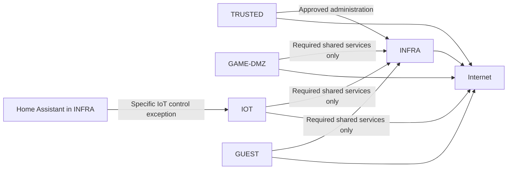

# VLAN Design and Security Zones

> **Public architecture documentation** — This file explains the network segmentation model, trust boundaries, and design decisions used in the HomeOps homelab. It is not a live configuration export, asset inventory, or proof of comprehensive network isolation.

## Purpose and Scope

HomeOps uses VLANs to separate devices and workloads by **role and trust level**, rather than operating everything on one flat LAN. Inter-VLAN communication is governed by a defined access-control policy, with limited exceptions for shared infrastructure services.

The goals are to:

- Reduce unnecessary lateral movement between device classes.
- Keep infrastructure management separate from personal clients and externally reachable workloads.
- Isolate IoT and guest endpoints from private resources.
- Allow only the cross-zone communication needed to operate services.
- Make the architecture understandable, testable, and maintainable.

This document describes **zone design and intended relationships**. Address allocation is documented in [`ip-plan.md`](ip-plan.md), inter-VLAN policy in [`acl-policy.md`](acl-policy.md), and switching concepts in [`port-mapping.md`](port-mapping.md).

---

## 1. Security-Zone Overview

| VLAN | Zone | Purpose | Trust consideration |
|---:|---|---|---|
| 1 | `DEFAULT` | Restricted legacy/default network | Not for normal client use |
| 10 | `INFRA` | Infrastructure, management, and internal services | Sensitive operational systems |
| 20 | `TRUSTED` | Trusted personal and administrative clients | Approved origin for routine management |
| 25 | `GAME-DMZ` | Game-server workloads | Externally oriented application risk |
| 30 | `IOT` | Smart-home and embedded devices | Lower-trust managed and consumer devices |
| 40 | `GUEST` | Temporary and untrusted clients | Internet-focused, limited internal access |

VLAN membership provides **Layer 2 separation**. It does not, on its own, prevent routed communication between zones. That boundary is enforced through the gateway's inter-VLAN access-control policy.

### High-Level Trust Model

**Interpretation:** Arrows show *intended permitted communication categories*, not unrestricted reachability. The shared-service arrows do **not** grant general access to `INFRA`; their effective scope depends on gateway and host policy. The diagram omits implementation details and does not replace an ACL review.

---

## 2. Zone Responsibilities

### VLAN 1 — `DEFAULT`

`DEFAULT` is retained for limited legacy/default-network requirements. It is **not** the normal trusted-client or administration zone.

**Design rationale:** Keeping ordinary clients off the default network makes their intended security role explicit. Device-specific dependencies and management placement are recorded privately rather than exposed in this public architecture overview.

### VLAN 10 — `INFRA`

`INFRA` houses core services and management interfaces, including categories such as:

- Proxmox hypervisors and virtual infrastructure management
- Storage, backup, and internal DNS services
- Network management and monitoring
- Internal applications and automation services

**Design rationale:** Infrastructure endpoints often have higher privileges and support multiple dependent services. Separating them from ordinary clients helps contain failures and reduces exposure to lower-trust endpoints.

`INFRA` is not intended to be generally reachable from `IOT`, `GUEST`, or `GAME-DMZ`. Specific service dependencies are handled through narrow policy exceptions.

### VLAN 20 — `TRUSTED`

`TRUSTED` contains approved personal endpoints and the primary administration workstation.

Routine administrative sessions originate here, while infrastructure services remain on `INFRA`. This separates the *administrative client* from the *managed systems* without requiring the client to reside on the infrastructure VLAN.

**Design rationale:** Management access is deliberately directional. Permission for a trusted client to initiate administration does not mean that infrastructure systems should be free to initiate unrelated sessions into the trusted-client zone.

### VLAN 25 — `GAME-DMZ`

`GAME-DMZ` is intended for game-server workloads that may accept connections from external players, including deployments using a relay or tunneling service such as Playit.gg.

**Design rationale:** Game servers may run third-party software, change frequently, and receive traffic from outside the homelab. Isolating their workloads reduces the consequences of a compromised game service.

The architecture distinguishes **hypervisor management** from **guest workload networking**. A physical Proxmox host may be managed through `INFRA` while its hosted game workload uses `GAME-DMZ`.

> Workload placement in this document is architectural intent, not a claim that every current or transitional deployment has been independently verified. The authoritative live VM-to-VLAN inventory is private.

### VLAN 30 — `IOT`

`IOT` is used for consumer smart-home devices, media equipment, and other embedded endpoints that do not require the same trust as administrative clients.

**Design rationale:** These devices can have limited update support and external cloud dependencies. Their network access should match their function rather than inheriting broad access to trusted clients or infrastructure.

Home Assistant runs as an infrastructure service, not as a general-purpose member of the IoT zone. Its device-control requirements are supported by a **targeted application exception** described below.

### VLAN 40 — `GUEST`

`GUEST` is intended for temporary or untrusted devices.

**Design rationale:** Guest Internet connectivity should not imply access to internal services, workstations, or infrastructure. Shared services such as DNS may be made available without opening the rest of the internal network.

---

## 3. Cross-Zone Communication

The segmentation model is **deny-oriented for lower-trust access to internal networks**, with documented exceptions where functionality requires them.

| Source zone | Destination / service | Intended relationship |
|---|---|---|
| `TRUSTED` | `INFRA` | Approved administration and internal services |
| `GAME-DMZ` | Internal zones | General access restricted; narrow shared-service exceptions |
| `IOT` | Internal zones | General access restricted; narrow shared-service exceptions |
| `GUEST` | Internal zones | General access restricted; narrow shared-service exceptions |
| `INFRA` | `IOT` | Restricted by default; specific application exception |
| Active zones | Internet | Available where required by role and policy |

This summary describes **new traffic initiated between zones**. It is not a firewall rule list. Return traffic, same-VLAN communication, IPv6, and host-based controls require separate consideration.

For the more detailed but still public-safe policy matrix, see [`acl-policy.md`](acl-policy.md).

### Shared DNS

Two Pi-hole instances provide internal DNS service. Lower-trust VLANs require name resolution without needing broad access to the infrastructure zone.

**Design principle:** Permit the required DNS service, not unrestricted access to the networks where the resolvers reside. Resolver endpoints, detailed rule objects, and client-specific configuration belong in private operational records.

### Home Assistant and IoT

Home Assistant is hosted in `INFRA` but needs to initiate connections toward some devices in `IOT`.

**Design principle:** Grant the application only the connectivity it needs; do not use this dependency as a reason to permit general infrastructure-to-IoT traffic.

### External Game Services

Game workloads may be made reachable to approved remote players through external connectivity services. Public reachability of an *application* should not imply public reachability of its hypervisor's management plane.

**Design principle:** Separate workload exposure, host management, and access-control policy. The exact exposure paths are intentionally not published here.

---

## 4. Virtual and Physical Networking

The homelab uses a TP-Link Omada-based network with an ER605 gateway, managed switching, and wireless access infrastructure.

- **Gateway:** Provides routing between the VLANs and enforces the documented gateway ACL policy.
- **Managed switches:** Transport the required VLANs across access and trunk links.
- **Proxmox hosts:** Support separation of host-management traffic from guest VM/LXC traffic using appropriate virtual and physical network configuration.
- **Wireless access point:** Supports placing wireless clients in the appropriate zone rather than sharing one undifferentiated wireless LAN.

The network uses a mix of access and trunk links as required by device roles. **Exact switchport assignments, VLAN allowlists, untagged/tagged memberships, and physical host connections are maintained privately.** See [`port-mapping.md`](port-mapping.md) for the public design principles.

### Management-Plane Separation

The design places routine infrastructure management in the infrastructure security model, with administration initiated from a trusted workstation.

Some equipment may have legacy or device-specific management dependencies. Their exact locations and access paths are intentionally omitted here and must be checked against the private inventory when making changes.

---

## 5. Discovery and Address Assignment

### mDNS and Multicast

The source documentation records **cross-VLAN mDNS/multicast forwarding as not generally enabled**. This avoids broad automatic service discovery between security zones.

If an application requires discovery across VLAN boundaries, the preferred approach is to identify the precise use case, evaluate the security impact, and deploy the smallest practicable exception rather than enabling unrestricted cross-zone discovery.

### DHCP and Addressing

Client address assignment uses DHCP where appropriate, while infrastructure services use stable addressing where dependencies require it. Subnets, gateway conventions, and DHCP scopes are described in [`ip-plan.md`](ip-plan.md).

This file deliberately does not duplicate per-host IP addresses, reservations, DHCP ranges, or lease settings. Their authoritative operational records are kept separately.

---

## 6. Design Rationale

| Decision | Reason |
|---|---|
| Segment by trust level rather than by individual application | Keeps the model understandable and avoids unnecessary VLAN proliferation |
| Use a distinct infrastructure zone | Separates sensitive services and management interfaces from clients |
| Place administrative clients in `TRUSTED` | Preserves operational access without putting the workstation in the server zone |
| Isolate game workloads | Limits lateral movement from externally oriented services |
| Treat IoT devices as lower trust | Reduces the reach of consumer devices into private networks |
| Keep guests separate | Provides Internet-oriented access without treating visitors as trusted |
| Permit narrow shared-service exceptions | Preserves DNS and automation functionality without broad network permissions |
| Restrict use of `DEFAULT` | Reduces dependence on a catch-all legacy network |

These decisions describe the **security architecture**, not a guarantee that every individual traffic path is protected under all conditions.

---

## 7. Validation and Operational Review

The original HomeOps documentation records all six VLANs and gateway ACL segmentation as active, with representative inter-VLAN paths function-tested. These statements are **historical documented observations**, not tests rerun as part of this rewrite.

Representative checks after significant changes should confirm that:

1. `TRUSTED` can reach the infrastructure services it is authorized to manage.
2. `GUEST`, `IOT`, and `GAME-DMZ` cannot initiate broad access to protected internal zones.
3. Required shared DNS resolution remains available across the relevant zones.
4. Home Assistant can reach the intended IoT devices without granting a broader exception.
5. Externally oriented workloads remain separate from hypervisor management.
6. Client addressing, Internet access, and intended service dependencies still function.
7. Prohibited connections are explicitly tested, not assumed to be blocked because another test passed.

A representative functional test does **not** prove complete isolation. Full assurance also depends on VLAN tagging, Layer 2 behavior, gateway/host firewalls, alternate protocols and paths, and ongoing configuration drift detection.

Detailed test evidence, active topology inventories, and unresolved findings are kept privately. Sanitized methodology and outcomes may be published separately.

---

## 8. Documentation and Change Control

When a device or service changes security zone:

1. Establish the required trust role and dependencies.
2. Review the intended inter-VLAN communication policy.
3. Verify the relevant virtual-network, switching, DHCP, DNS, and access-control implications.
4. Document the live configuration and rollback plan **privately** before making changes.
5. Apply the change and test both permitted and prohibited paths.
6. Update the private asset/network inventory and this public design document if the architecture has changed.

### Public / Private Boundary

| Suitable for public HomeOps | Maintain privately |
|---|---|
| VLAN IDs, names, and security purposes | Device-to-VLAN inventory and management endpoints |
| High-level trust relationships | Exact ACL sequence and live rule objects |
| Design rationale and service dependencies | Exact switchport configurations and network exports |
| Sanitized validation summaries | Test captures, recovery paths, and unresolved security findings |
| General change-control principles | Device-specific access and rollback procedures |

Passwords, tokens, private keys, and recovery codes belong in a secrets manager, **not** in public or standard private Git documentation.

**Git history:** Replacing this file does not remove details from earlier public commits. History cleanup, if required, must be considered separately.

---

## Related Documentation

- [`README.md`](README.md) — network overview
- [`ip-plan.md`](ip-plan.md) — VLAN subnets, DHCP, and DNS architecture
- [`acl-policy.md`](acl-policy.md) — high-level inter-VLAN access policy
- [`port-mapping.md`](port-mapping.md) — public switching and connectivity design
- [`../security/segmentation.md`](../security/segmentation.md) — broader security and segmentation context
- [`../services/pihole.md`](../services/pihole.md) — DNS service
- [`../services/home-assistant.md`](../services/home-assistant.md) — home automation service
- [`../services/game-servers.md`](../services/game-servers.md) — hosted game workloads

---

**Documentation status:** Public, intentionally abstracted architecture. The deployed Omada, Proxmox, and host configurations remain authoritative for current operation.
